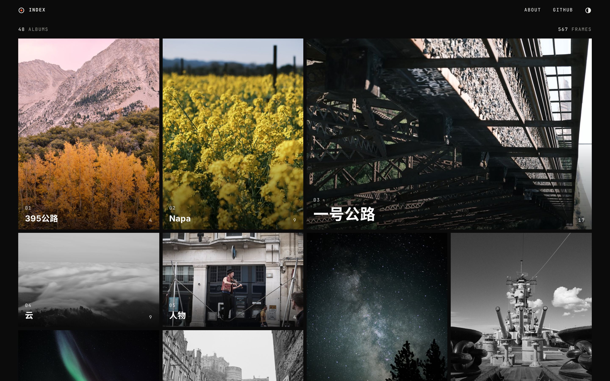
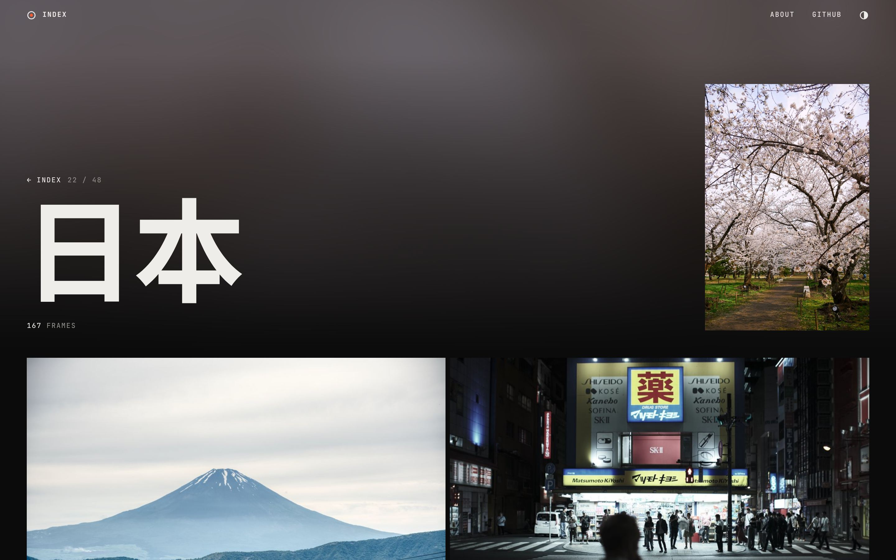
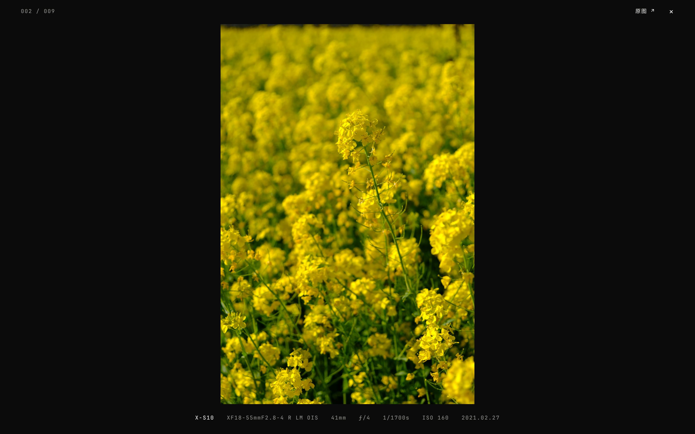
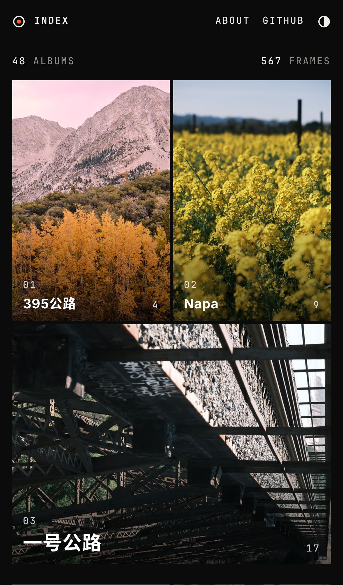

# 摄影博客

一个摄影博客的静态站点生成器和它的主题：读 `config.json` 里的相册与照片，生成纯静态页面。



| 相册页 | 灯箱 | 手机 |
| --- | --- | --- |
|  |  |  |

## 特点

- **首页是一面拼贴墙**：竖构图的封面占竖格，横构图的每隔几张放大一格，生成时会自动调整，尽量不留空格。
- **相册页是等高排版**：每张照片保持原始比例，同一行等高并撑满整行。排版是纯 CSS 的，尺寸在生成时就写进了页面，图片加载过程中页面不会跳动。
- **灯箱**：缩略图原地放大进入；支持键盘 ← → / Esc、手机左右滑动和下拉关闭、浏览器返回键关闭；地址栏里带着照片名（如 `/Napa/#DSCF0336`），可以直接分享某一张。有 EXIF 的照片会显示机身、镜头、焦距、光圈、快门、ISO 和日期。
- **按需加载原图**：先显示缩略图，只有当屏幕像素确实比缩略图多时才去取原图；省流量模式或 2G 网络下不自动取。
- **转场**：从封面进入相册、打开灯箱、切换深浅色都有过渡动画，由浏览器的 View Transitions 完成；不支持的浏览器直接切换，功能不受影响。
- **轻**：没有任何前端依赖和网络字体。全站一份 CSS（16 KB）、一份 JS（9 KB），gzip 后合计约 8 KB。
- 深色 / 浅色两套配色，记住上次的选择；关闭 JavaScript 时照片照常显示，点击直接打开原图。

## 使用

需要 Go 1.21 或更新版本。

```bash
go run ./cmd/photoblog
```

站点生成在 `public/`，把它作为网站根目录即可。本地预览：

```bash
python3 -m http.server -d public 8000
```

可选参数：

| 参数 | 默认值 | 说明 |
| --- | --- | --- |
| `-config` | `config.json` | 相册与照片的配置 |
| `-theme` | `template` | 主题目录 |
| `-out` | `public` | 输出目录 |
| `-images` | `image` | 本地照片目录，存在时原样复制到输出目录 |
| `-meta` | `photos.json` | 照片尺寸与 EXIF 的缓存 |
| `-offline` | | 不联网读取缓存里没有的照片 |
| `-refresh` | | 忽略缓存，全部重新读取 |

## 配置

`config.json` 是一棵树：有 `children` 的节点是相册，只有 `url` 的节点是照片，根节点是站点本身。相册可以嵌套。

```json
{
  "title": "我的摄影博客",
  "description": "写给搜索引擎和分享卡片的简介",
  "children": [
    {
      "title": "日本",
      "url": "https://photo-r2.example.com/cover.jpg",
      "children": [
        { "url": "https://photo-r2.example.com/DSCF0001.jpg" },
        { "url": "/image/local.jpg" }
      ]
    }
  ]
}
```

- 相册的 `url` 是封面，不写则用相册里的第一张。
- 站点标题只出现在浏览器标签页和分享卡片里，页面上不显示。
- 以 `http` 开头的是远程照片；其他的是本地照片，`/image/a.jpg` 对应仓库里的 `image/a.jpg`。
- 地址里带 `photo-r2` 的照片，缩略图取自把它换成 `photo-thumbs-r2` 的地址（规则在 `internal/site/site.go` 的 `ThumbURL`）；其他照片直接用原图当缩略图。
- 想手动指定某张照片的拍摄参数，可以给它加上 `exif`：

  ```json
  { "url": "…", "exif": { "model": "X-S10", "focal": "35mm", "aperture": "ƒ/2", "shutter": "1/250s", "iso": "ISO 160" } }
  ```

## 照片信息缓存

生成时需要知道每张照片的尺寸（排版用）和 EXIF（灯箱里显示）。生成器只读每个文件开头的 128 KB，不会下载整张原图，结果存在 `photos.json` 里。

- 缓存里已有的照片不会再联网，所以把 `photos.json` 一起提交，构建就很快。
- 缓存里没有的照片会在构建时现查；CI 上也一样，只是结果不会写回仓库。
- 读取失败的照片按 3:2 排版，不会让构建失败，下次构建会再试。
- 如果缩略图没有按原图的 EXIF 方向旋转，构建时会给出警告。
- 换过缩略图之后，用 `go run ./cmd/photoblog -refresh` 重新读取全部照片。

## 管理后台

`admin/` 是一个 Cloudflare Worker，用来给 R2 里的照片打标签、补缩略图、发布相册。它通过 R2 binding 直接读写两个 bucket，不需要 S3 密钥。

- **标签**：一个标签就是一个相册，存在照片对象的自定义元数据 `tag` 字段里，逗号分隔。可以在卡片上输入、从左侧拖到照片上，或者勾选多张后批量添加和移除。R2 不能原地修改元数据，所以每次改标签都会把那张照片原样重写一遍（流式转存，文件内容和其他元数据不变）。
- **缩略图**：点「生成缩略图」，由浏览器取回原图、按 EXIF 转正、用 Lanczos 缩到最长边 1024、存成质量 85 的 JPEG，再传到缩略图 bucket 的同名 key。这一步放在浏览器里，是因为 Worker 的内存和 CPU 限额处理不了两千多万像素的原图。
- **发布**：按当前标签生成 `config.json` 并提交到仓库，随后由 GitHub Actions 部署。站点标题、相册简介和封面沿用已发布的内容；新相册、或者封面照片已不在其中的相册，随机选一张做封面。内容没有变化时不会提交。

### 部署后台

后台由 GitHub Actions 自动部署：`admin/` 有改动并推送到 `master` 时，`.github/workflows/admin.yml` 会先跑类型检查和测试，再执行 `wrangler deploy`。也可以在 Actions 页面手动运行这个工作流。

需要在仓库的 **Settings** → **Secrets and variables** → **Actions** 里添加两个 secret：

| Secret | 内容 |
| --- | --- |
| `CLOUDFLARE_API_TOKEN` | Cloudflare 的 API token，用 **Edit Cloudflare Workers** 模板创建，范围限定到自己的账号 |
| `CLOUDFLARE_ACCOUNT_ID` | Cloudflare 的账号 ID |

第一次部署之后，还要做两件事：

1. 打开登录：在控制台进入 **Workers & Pages** → `photography-blog-admin` → **Access**，选 **Protect this Worker behind Access**，范围选 **All traffic**，策略选 **Cloudflare account**（只有这个 Cloudflare 账号的成员能登录），然后 **Apply Access**。账号需要已经启用 Zero Trust。想接入别的身份提供商或者用更细的策略，可以到 Zero Trust 里编辑这个 Access 应用。
2. 可选：给 Worker 设置 `GITHUB_TOKEN`，「发布」才能直接提交。用 GitHub 的 fine-grained token，只授权这个仓库，权限给 Contents 的 Read and write。在控制台里 Worker 的 **Settings** → **Variables and Secrets** 添加，类型选 Secret；或者在本地运行 `npx wrangler secret put GITHUB_TOKEN`。不设置的话，可以点「下载 config.json」后自己提交。

两个 bucket 的名字写在 `admin/wrangler.jsonc` 的 `r2_buckets` 里。想从本地部署的话（需要 Node 22 或更新版本）：

```bash
cd admin
npm ci
npx wrangler deploy
```

登录完全交给 Cloudflare Access，Worker 自己不存任何密码：只有经过 Access 的请求才会被处理，页面也一样。没有为这个 Worker 开启 Access 时，所有请求都会被拒绝（403）。此外，改动数据的请求必须来自后台自己的页面。

### 本地运行和测试

```bash
cd admin
npm run dev    # 用本地模拟的空 bucket，并模拟一个已登录的用户
npm test       # 在本地的 Workers 运行时里跑集成测试
```

依赖只有 `wrangler` 和 `typescript` 两个开发工具，版本锁定在 `package-lock.json` 里。

## 部署

推送到 `master` 后，GitHub Actions（`.github/workflows/go.yml`）会构建站点并发布到 `page` 分支。

## 修改主题

主题在 `template/` 下，一共四个文件：

```
template/
  index.html      所有页面共用的模板（Go html/template）
  favicon.svg
  assets/app.css  样式；颜色和间距都是文件开头的变量
  assets/app.js   主题切换和灯箱
```

除 `index.html` 外的文件会原样复制到输出目录。顶栏和页脚里的 About、GitHub 链接直接写在 `index.html` 里。

模板拿到的是当前页面（`internal/site/site.go` 里的 `Album`）：

| 字段 | 含义 |
| --- | --- |
| `.Home` `.NotFound` | 是否首页 / 404 页 |
| `.Title` `.Description` `.Href` | 标题、简介、地址 |
| `.Cover` | 封面照片 |
| `.Count` `.Num` `.Of` | 照片数、在同级相册中的序号、同级相册总数 |
| `.Crumbs` | 上级页面，`.Title` 和 `.Href` |
| `.Albums` | 子相册，每个都是同样的结构，另有 `.Shape`（拼贴墙里的格子形状） |
| `.Photos` | 照片：`.URL` `.Thumb` `.Name` `.N` `.W` `.H` `.Ratio` `.Info` |
| `.Next` | 下一个同级相册 |
| `.Site` | 全站信息：`.Title` `.Description` `.Albums` `.Photos` `.Year` `.Rev` |

## 代码结构

```
cmd/photoblog        命令行入口
internal/config      读取 config.json
internal/photo       读取照片尺寸和 EXIF，以及 photos.json 缓存
internal/site        把配置变成页面并写出
admin/               管理后台（Cloudflare Worker，TypeScript）
  src/               接口：照片与标签、缩略图、生成并发布 config.json
  pages/             页面，以及在浏览器里生成缩略图的脚本
```

```bash
go test ./...
```

## 来源

生成器最初 fork 自 [hangbale/photography-blog](https://github.com/hangbale/photography-blog)，MIT 许可。
